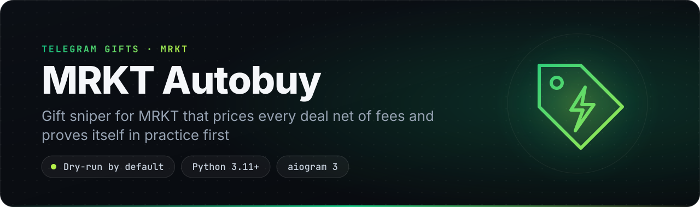
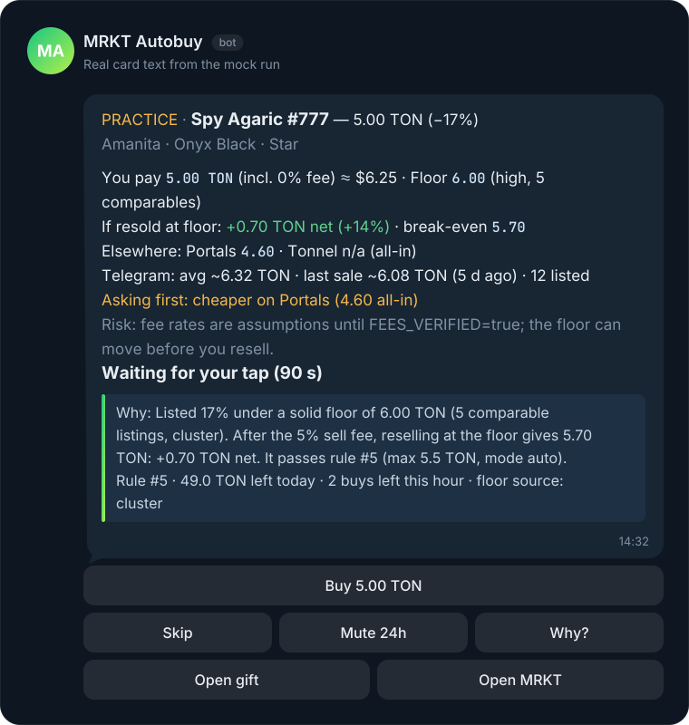
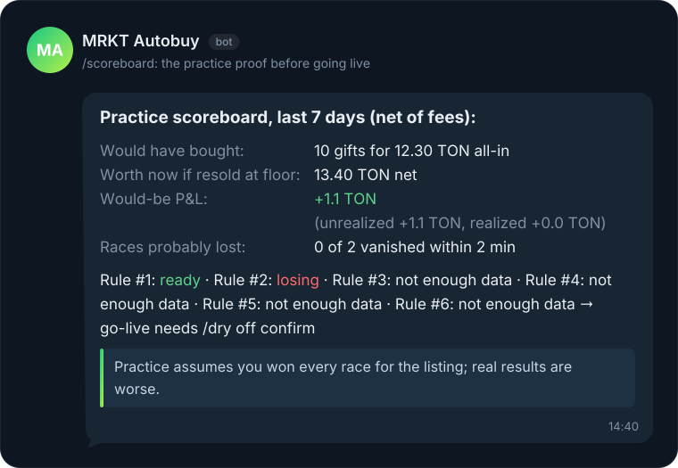
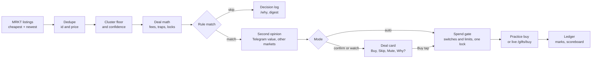

<p align="center">
  
</p>

<p align="center">
  
  
  
  
  
  
  
  
</p>

<p align="center">
  <b>A self-hosted Telegram gift sniper for MRKT that shows the profit after fees and only buys when the numbers hold up.</b><br>
  <a href="#features">Features</a> · <a href="#quick-start">Quick start</a> · <a href="#commands">Commands</a> · <a href="#how-it-works">How it works</a> · <a href="#safety">Safety</a> · <a href="#roadmap">Roadmap</a>
</p>

MRKT Autobuy watches the [MRKT](https://t.me/mrkt) marketplace for Telegram gifts that match your rules. It sends you a deal card for each one and, if you allow it, buys. Most alert feeds and snipers stop at "X% under the floor". This bot works out what you actually pay and what a resale at the floor leaves you after fees. It also checks how solid that floor is, and compares the price with Telegram's own valuation and with other markets.

It starts in practice mode and stays there until you turn live mode on. Live mode lasts 24 hours at a time, within hard limits, and `/panic` stops it at once. It runs on your own Telegram account and your own MRKT balance: no deposits, no shared sessions, no closed binaries.

> **Status: alpha.** The full pipeline runs offline in `mock` mode and in 239 tests. The live MRKT endpoints come from the MRKT web app and community clients, but no real purchase has been made with them yet. Read [Before going live](#before-going-live) first.

## Why it's different

- **Profit after fees, not discount to floor.** Every card shows the all-in cost, the net result of a resale at the floor after the sell fee, and the break-even price. A deal that loses money after fees is skipped, however big the discount looks. The MRKT sell fee is learned per collection from the listing data.
- **A floor you can trust, with a confidence level.** One seller with two cheap listings can fake a "second-cheapest" floor. This bot uses a cluster floor instead: the lowest ask with at least two other asks within 10% above it. Each floor is labeled `high`, `med` or `low` by how many comparable listings back it, and it drops a level when the floor moves more than 25% within an hour. A floor that no cluster of at least 3 listings backs is always `low`, so two decoy listings can never pass the default `med` minimum.
- **A second opinion before it spends.** It checks Telegram's own valuation of the exact gift (`payments.getUniqueStarGiftValueInfo`, which none of the snipers we reviewed use) and the same gift's floor on other markets such as Portals and Tonnel. If the gift is cheaper elsewhere, or priced above both Telegram's average and its last sale on a thin floor, the bot asks you first instead of buying.
- **It proves itself in practice before it touches your money.** Practice buys are marked against the floor and reported net of fees in `/scoreboard`, which also counts races you probably lost. Each rule gets a verdict (`ready`, `losing` or `not enough data`). Live mode turns off by itself after 24 hours.
- **Non-custodial and fully open.** Unlike custodial sniper bots that ask for a TON or Stars deposit, this one runs on your server with your account. Every decision, including each skip, is logged, and `/why` explains it in plain words.

## Features

| | Feature | What you get |
|---|---|---|
| 🎯 | **Rule-based sniping** | Rules by collection, model, backdrop and symbol, with a max price (fees included), min discount, min profit in TON or %, min floor confidence and lock tolerance. Polls MRKT every 2 s for the cheapest and the newest listings. |
| 🧮 | **Net-of-fees math** | All-in cost, net exit at the floor, profit in TON and %, and the break-even price on every card, plus an optional USD amount. |
| 📉 | **Honest floor** | A cluster floor with `high`/`med`/`low` confidence, floor snapshots over time, and a fallback to the collection floor. |
| 🪤 | **Trap filter** | Lucky-buy tickets and listings with an unknown price unit are blocked. Premarket gifts are skipped unless a rule allows the lock. A price under 25% of the floor is never auto-bought. |
| 🃏 | **Deal cards** | Per-rule mode: `auto`, `confirm` or `watch`. Buttons for Buy, Skip, Mute 24h and Why?. The price is re-checked before a tap buys, cards expire after 90 s, and a double tap is safe. |
| 🤏 | **Near-miss nudges** | A silent card when one check misses by 5% or less, with a one-tap "Raise max" (at most 3 an hour). |
| 🔍 | **Second opinion** | Telegram's valuation (average, last sale, listed count), Portals and Tonnel floors, and `/compare` across markets all-in and net. |
| 🧪 | **Practice first** | A practice ledger with marks, `/pnl`, `/scoreboard`, per-rule verdicts, CSV export, and a live gate that expires after 24 h. |
| 🛡️ | **Safety envelope** | `/safety`, `/panic`, limit presets that never go above your `.env` limits, and breakers for a floor crash, a losing streak, a balance mismatch and repeated failed buys. |
| 🪄 | **`/hunt` wizard** | Set up a rule in at most 6 taps, or paste a `t.me/nft/...` link. It shows what the rule would have caught in the last 24 h before you save. |
| 🌓 | **Shadow rules** | New rules start in shadow (practice only, even in live mode). A hindsight card offers to promote them once they have enough data. |
| 🧾 | **Explained decisions** | Every evaluation goes to a `decisions` table and `data/events.jsonl`. You also get `/why`, an optional daily digest with tuning hints, and an optional "Explain more" button that uses Claude. |
| 🩺 | **`/doctor`** | Checks config, Telegram session, 2FA, session file permissions, MRKT auth, reachability, clock, database, fees and limits, with a fix for each failing item. |

## See it in action

<p align="center">
  
</p>

The rule is in `auto` mode and the deal is +0.70 TON net after fees, but the same gift is cheaper on Portals, so the bot asks first instead of buying.

An excerpt of `python -m mrkt_autobuy mock --cycles 2`, which runs offline with fixture data and no keys:

```text
MOCK mode: 6 demo rules, 2 cycle(s), PRACTICE forced (DRY_RUN lock), tap=none
  ...
  Fees: buy 0% · sell 5% · withdraw 0 TON (unverified)

--- cycle 1 ---
[notify] DEAL Lunar Snake #4410 1.00 TON · floor 1.60 (cluster, 4 comparables, high) · you pay 1.00 incl. 0% fee · resold at floor: +0.52 TON net (+52%) · break-even 1.52
  PRACTICE · Lunar Snake #4410 — 1.00 TON (−38%)
  Albino · Onyx Black · Star
  You pay 1.00 TON (incl. 0% fee) ≈ $1.25 · Floor 1.60 (high, 4 comparables)
  If resold at floor: +0.52 TON net (+52%) · break-even 1.52
  Elsewhere: Portals 1.75 · Tonnel n/a (all-in)
  Telegram: avg ~2.00 TON · last sale ~1.92 TON (3 d ago) · 41 listed
  Risk: fee rates are assumptions until FEES_VERIFIED=true; the floor can move before you resell.
  PRACTICE: would buy
  Why: Listed 38% under a solid floor of 1.60 TON (4 comparable listings, cluster). After the 5% sell fee, reselling at the floor gives 1.52 TON: +0.52 TON net. It passes rule #1 (max 2.5 TON, discount ≥ 10%, profit ≥ 0.1 TON, mode auto).
  Rule #1 · 50.0 TON left today · 3 buys left this hour · floor source: cluster
  [buttons: Mute 24h | Why? | Open gift | Open MRKT]
...
[notify] NEAR MISS PRACTICE · Desk Calendar #3001 — 2.62 TON (−18%)
  Missed by a hair: 2.62 TON, your max is 2.50
  You pay 2.62 TON · Floor 3.20 (high, 6 comparables) · resold at floor: +0.42 TON net
  Rule #3. Near-miss nudges are silent and capped per hour.
  [buttons: Raise max to 2.65 | Ignore today]
...
cycle 1: rules=6 fetched=30 new=30 matches=5 dry_buys=1 buys=0 cards=4 skipped=0 failed=0 · requests=13
  skip #4412 0.97 TON: loses 0.02 TON after fees (rule #2)
  ...
  skip #54 1.10 TON: lucky-buy ticket, not a plain listing (rule #4)
  skip #53 1.20 TON: locked: premarket: unlocks in 6 d (rule #4)
  ...

--- /scoreboard ---
Practice scoreboard, last 7 days (net of fees):
Would have bought: 10 gifts for 12.30 TON all-in
Worth now if resold at floor: 13.40 TON net
Would-be P&L: +1.1 TON (unrealized +1.1 TON, realized +0.0 TON)
Races probably lost: 0 of 2 vanished within 2 min
...

--- summary ---
...
client.buy() calls: 0 (practice never buys)
skip reasons: OVER_MAX 16 · LOW_CONFIDENCE 6 · LOSES_AFTER_FEES 1 · TRAP_LUCKY 1 · LOCKED 1 · ABOVE_TG_VALUE 1 · CHEAPER_ELSEWHERE 1 · TOO_GOOD 1
```

The mock run also prints `/pnl`, `/score`, the `/dry off` gate, `/why`, the digest, `/safety`, `/peers` and `/compare`. Extra flags show the other paths: `--tap buy` (re-check before a tapped buy, double taps, the hourly cap), `--crash` (floor-crash breaker), `--panic`, `--preview "<rule>"`, `--doctor` and `--shadow-hours 0`.

<p align="center">
  
</p>

## Quick start

1. **Try it with zero keys.** Clone, install, and run the offline mock. You need Windows 10/11 (x64) with Python 3.11 or newer.

   ```powershell
   git clone https://github.com/smashguidetram/mrkt-autobuy.git
   ```
   ```powershell
   cd mrkt-autobuy
   ```
   ```powershell
   py -3 -m venv .venv
   ```
   ```powershell
   .venv\Scripts\pip install -r requirements.txt
   ```
   ```powershell
   .venv\Scripts\python -m mrkt_autobuy mock --cycles 2
   ```

2. **Create your bot.** In Telegram, open [@BotFather](https://t.me/BotFather), send `/newbot`, choose a name and a username, and copy the token it gives you. That token is `BOT_TOKEN`.

3. **Find your numeric Telegram ID.** Send any message to [@userinfobot](https://t.me/userinfobot). It replies with your `Id`, which goes in `ADMIN_IDS`. Only these IDs can use the bot and its buttons; separate several with commas.

4. **Get Telegram API credentials.** Sign in at [my.telegram.org](https://my.telegram.org), open *API development tools* and create an app. Copy `api_id` and `api_hash` into `TG_API_ID` and `TG_API_HASH`. The bot uses them to open the MRKT Mini App as you, which is how MRKT authenticates.

5. **Configure `.env`.** Copy the example, then fill in the four keys from steps 2-4. Leave `DRY_RUN=true` for now.

   ```powershell
   copy .env.example .env
   ```

6. **Log in once.** This asks for your phone number, the login code and your 2FA password if you have one. It saves the session to `data/mrkt.session` (mode 600) and checks MRKT auth and your balance.

   ```powershell
   .venv\Scripts\python -m mrkt_autobuy login
   ```

7. **Check the setup.** Each failing item comes with a fix. The exit code is 1 if anything fails.

   ```powershell
   .venv\Scripts\python -m mrkt_autobuy doctor
   ```

8. **Run it.**

   ```powershell
   .venv\Scripts\python -m mrkt_autobuy run
   ```

9. **Add your first rule.** In your bot, send `/start`, then `/hunt`, and tap through the wizard. Watch `/scoreboard` for a few days before you consider `/dry off`.

## Self-hosting

The bot is a single Python process with a SQLite database in `data/`. It needs no inbound ports, because it polls Telegram and MRKT.

### Windows

This is a Windows build: install it on Windows 10/11 (x64) with Python 3.11 or newer from [python.org](https://www.python.org/downloads/windows/) (tick *Add python.exe to PATH*). The CLI refuses to start anywhere else (`This build is Windows-only.`), because the packaged companion runtime is a Windows program.

1. Get the code and set up a virtual environment:

   ```powershell
   git clone https://github.com/smashguidetram/mrkt-autobuy.git
   cd mrkt-autobuy
   py -3 -m venv .venv
   ```

2. Install, configure, log in and check, as in Quick start steps 4-7:

   ```powershell
   .venv\Scripts\pip install -r requirements.txt
   ```
   ```powershell
   copy .env.example .env
   ```
   ```powershell
   .venv\Scripts\python -m mrkt_autobuy login
   ```
   ```powershell
   .venv\Scripts\python -m mrkt_autobuy doctor
   ```

3. Start it, and keep it running. The bot runs in the window you start it from; close the window and it stops. To start it with the machine, register it with Task Scheduler:

   ```powershell
   .venv\Scripts\python -m mrkt_autobuy run
   ```
   ```powershell
   schtasks /Create /TN "mrkt_autobuy" /TR "cmd /c cd /d %USERPROFILE%\mrkt-autobuy && .venv\Scripts\python -m mrkt_autobuy run" /SC ONLOGON
   ```
Install on Windows only: there is no Docker image and no Linux service file in this release.

### Free by default

Everything in this repo works without paid API keys.

| Key | Required? | Where to get it | Cost |
|---|---|---|---|
| `BOT_TOKEN` | Yes, for `run` | [@BotFather](https://t.me/BotFather) → `/newbot` | Free |
| `ADMIN_IDS` | Yes, for `run` | [@userinfobot](https://t.me/userinfobot) shows your numeric ID | Free |
| `TG_API_ID`, `TG_API_HASH` | Yes, for live market data (`login`, `run`, `once`, `floors`). They also enable Telegram's valuation and `/hunt` link lookup | [my.telegram.org](https://my.telegram.org) → API development tools | Free |
| `MRKT_TOKEN` | No | A token from MRKT's `/auth`. Set it only to skip Telethon until it expires | Free |
| `HTTP_PROXY` | No | Any HTTP or SOCKS5 proxy, if MRKT rate-limits your IP | Your proxy provider's price |
| `TON_RATE_URL` | No (preset) | tonapi.io public rates endpoint, no key | Free |
| `PEER_PORTALS_PUBLIC` | No (off) | Portals' public collections endpoint, no key | Free |
| `PEER_FLOOR_FILES` | No | Floor snapshot files written by other bots you run (schema below) | Free |
| `ANTHROPIC_API_KEY` | No (also needs `pip install anthropic`) | [console.anthropic.com](https://console.anthropic.com) | Paid per use. Without it the "Explain more" button is hidden and no call is made; `/why` works without it |

Live buying needs TON on your MRKT balance. Practice mode needs none.

## Configuration

All settings live in `.env`. If a required key is missing, the command stops with one line such as `Config error: BOT_TOKEN is not set. Add it to .env (see .env.example).`

| Key | Default | Meaning |
|---|---|---|
| `DRY_RUN` | `true` | Hard practice lock. While it is `true`, no bot command or stored setting can turn on live mode. |
| `MAX_PRICE_TON` | `10` | Max all-in cost of one gift, fees included. Caps every rule. |
| `DAILY_BUDGET_TON` | `50` | Spend limit for a rolling 24 hours, all-in. |
| `MAX_BUYS_PER_HOUR` | `3` | Max buys in the last hour. |
| `LIVE_ARM_HOURS` | `24` | How long `/dry off` keeps live mode on before it reverts to practice. |
| `CONFIRM_ABOVE_TON` | `0` | Buys above this always ask first, even in `auto`. `0` means half of `MAX_PRICE_TON`. |
| `SELL_FEE_PCT` | `5` | Assumed MRKT sell fee. It is also learned per collection from `salePriceWithoutFee`. |
| `FEES_VERIFIED` | `false` | Set to `true` once you have checked MRKT's fees. Until then, cards and `/status` say the fees are assumptions. |
| `CONFIRM_TTL_SEC` | `90` | How long a confirm card waits for your tap. |
| `SHADOW_NEW_RULES` | `true` | New rules from `/addrule`, `/hunt` and `rules.json` start in shadow (practice only) until promoted. |
| `POLL_INTERVAL` | `2` | Seconds between cycles. On 429s and errors it backs off exponentially, up to `MAX_BACKOFF`. |
| `RULES_FILE` | `rules.json` | Optional rules file, loaded at every start. |

<details>
<summary>All settings</summary>

Every key is documented in [`.env.example`](.env.example), in these groups:

- **Admin bot:** `BOT_TOKEN`, `ADMIN_IDS`
- **Telegram account (Telethon):** `TG_API_ID`, `TG_API_HASH`, `TG_SESSION_NAME`, `MRKT_BOT_USERNAME`, `MRKT_APP_SHORT_NAME`, `MRKT_WEBAPP_URL`, `INIT_DATA_TTL`
- **MRKT API:** `MRKT_API_BASE`, `MRKT_TOKEN`, `HTTP_BACKEND` (`curl_cffi` or `httpx`), `HTTP_PROXY`, `HTTP_TIMEOUT`
- **Safety and limits:** `DRY_RUN`, `MAX_PRICE_TON`, `DAILY_BUDGET_TON`, `MAX_BUYS_PER_HOUR`, `LIVE_ARM_HOURS`, `CONFIRM_ABOVE_TON`, `CRASH_PCT`, `CRASH_PAUSE_MIN`, `LOSS_STREAK_N`, `LOSS_STREAK_PCT`, `BALANCE_GUARD`, `BALANCE_TOLERANCE_TON`, `AUTO_PAUSE_ERRORS`, `STALE_DATA_SEC`, `HOT_WALLET_WARN_X`
- **Fees:** `BUY_FEE_PCT`, `SELL_FEE_PCT`, `WITHDRAW_FEE_TON`, `FEES_VERIFIED`
- **Honest floor and trap filter:** `CLUSTER_K`, `CLUSTER_BAND_PCT`, `MIN_COMPARABLES_COLLECTION`, `MIN_COMPARABLES_ATTR`, `FLOOR_JUMP_PCT`, `TOO_GOOD_PCT`, `OBS_TTL_DAYS`, `SNAPSHOT_TTL_DAYS`, `DECISIONS_TTL_DAYS`
- **Deal cards:** `CONFIRM_TTL_SEC`, `NEAR_MISS_PCT`, `NEAR_MISS_MAX_PER_HOUR`, `PREVIEW_HOURS`, `DISPLAY_CURRENCY` (`usd` or `none`)
- **Second opinion:** `PEERS_TIMEOUT_SEC`, `TG_VALUE_ENABLED`, `TG_VALUE_TTL`, `TG_VALUE_MAX_PER_MIN`, `TG_VALUE_GUARD`, `TON_RATE_URL`, `TON_RATE_TTL`, `PEER_FLOOR_FILES`, `PEER_MAX_AGE_SEC`, `PEER_PORTALS_PUBLIC`, `PORTALS_PUBLIC_URL`, `PORTALS_PUBLIC_TTL`, `CHEAPER_ELSEWHERE_PCT`
- **Practice ledger, live gate and digest:** `PAPER_HORIZON_DAYS`, `MARK_MAX_AGE_SEC`, `MARK_MAX_QUERIES`, `MARK_INTERVAL_SEC`, `GATE_MIN_TRADES`, `GATE_DAYS`, `DIGEST_HOUR` (`-1` = off), `TZ_OFFSET_HOURS`
- **Shadow rules, event log and optional LLM:** `SHADOW_NEW_RULES`, `SHADOW_MIN_HOURS`, `SHADOW_MIN_MATCHES`, `SHADOW_MAX_HOURS`, `SNIPED_WINDOW_SEC`, `EVENTS_FILE`, `EVENTS_MAX_MB`, `PEER_EVENT_FILES`, `ANTHROPIC_API_KEY`, `ANTHROPIC_MODEL`
- **Polling:** `POLL_INTERVAL`, `MAX_BACKOFF`, `PAGE_SIZE`, `SCAN_NEWEST`, `FLOOR_CACHE_TTL`
- **Storage:** `DB_PATH`, `DATA_DIR`, `RULES_FILE`, `LOG_LEVEL`

</details>

### Rules

The easiest way to make a rule is `/hunt` in the bot. You can also use `/addrule` or a `rules.json` file, which is a JSON list of objects. See [`rules.example.json`](rules.example.json).

| Key (`/addrule` alias) | Meaning |
|---|---|
| `collection` | Collection name, required. Matching ignores case and spaces. |
| `max_price_ton` (`max`) | Max all-in cost in TON, required and above 0. To switch a rule off, use `enabled`. |
| `model`, `backdrop`, `symbol` | Optional attribute filters. |
| `min_discount_pct` (`discount`) | Min discount to the floor, in %. |
| `min_profit_ton` (`profit`), `min_profit_pct` (`profit%`) | Min net profit of a resale at the floor, after fees. |
| `min_confidence` (`conf`) | `low`, `med` (default) or `high`. |
| `allow_locked_days` (`locked`) | Max lock in days you accept. `0` (default) never buys locked gifts. |
| `mode` | `auto` (default), `confirm` or `watch`. |
| `exit` | `here` (default) or `best`, which shows the best exit across markets. |
| `enabled` | `false` keeps the rule but turns it off. |
| `state` | `live`, `shadow` (practice only, even in live mode) or `paused` (skipped). Without it, a new file rule starts in shadow (with `SHADOW_NEW_RULES=true`, else `live`) and an existing one keeps its stored state, such as a promotion. |

On every `run` and `once`, the file is the source of truth for file rules (apart from a stored `state`, see above). Each entry is updated in place, entries removed from the file are deleted, and new ones are added. Rules made in the bot are not touched. A file rule keeps its ID, and with it its practice verdict, scoreboard, crash pause and pending cards, as long as its `collection`, `model`, `backdrop` and `symbol` stay the same. `rules.json` is in `.gitignore`.

<details>
<summary>Floor snapshot schema (<code>PEER_FLOOR_FILES</code>, <code>floors --json</code>)</summary>

At most once per `FLOOR_CACHE_TTL` (60 s), this bot writes its own MRKT floors to `data/floors_mrkt.json`, using an atomic write. Other bots you run can read that file, and this bot reads theirs through `PEER_FLOOR_FILES`. No network is involved and the files hold no secrets. Files older than `PEER_MAX_AGE_SEC` are ignored.

```json
{
  "schema": 1,
  "market": "mrkt",
  "ts": 1793221712.1,
  "fees": {"buy_pct": 0.0, "sell_pct": 5.0, "withdraw_ton": 0.0},
  "collections": {
    "lunarsnake": {"name": "Lunar Snake", "floor": 0.97, "n": 0, "models": {"albino": 1.0, "cobra": 0.97}}
  }
}
```

Keys are lowercase letters and digits only. `n` is the number of listings behind the floor, or `0` when unknown (as in this bot's own file).

</details>

## Commands

### Telegram bot

Only users in `ADMIN_IDS` can use these commands and buttons. Everyone else's taps get "Not allowed".

| Command | What it does |
|---|---|
| `/start` | What the bot does, its current mode and limits, and three commands to try first (`/hunt`, `/scoreboard`, `/doctor`). With no rules yet, it opens the `/hunt` wizard. |
| `/help` | Current mode and limits, plus every command. |
| `/safety` | Mode, every limit, spend today and this hour, live-gate status and breakers. |
| `/panic` | Stops all buying at once: pauses, forces practice, expires pending cards. |
| `/resume` | Asks for confirmation with a one-time button (it expires after 10 minutes, and any later `/pause`, `/panic` or breaker voids it), then clears pause and panic. The mode stays practice until a new `/dry off`. |
| `/pause` | Pauses sniping. |
| `/dry on\|off` | `on` switches to practice. `off` shows the practice report and a one-time "Go live for 24 h" button when every rule is `ready`. `/dry off confirm` goes live anyway. `off` needs `DRY_RUN=false` in `.env`. |
| `/status` | Engine state, cycles, errors, top skip reasons and fee assumptions. |
| `/doctor` | Self-check with a fix for each failing item. |
| `/hunt` | Tap-to-hunt wizard: collection, model, goal, max price, mode, then Save. Shows a 24 h preview. |
| `/rules` | Lists rules (`[bot]` or `[file]`). |
| `/addrule <collection> max=<ton> [model=..] [backdrop=..] [symbol=..] [discount=<pct>] [profit=<ton>] [profit%=<pct>] [conf=low\|med\|high] [locked=<days>] [mode=auto\|confirm\|watch] [exit=here\|best]` | Adds a rule. Multi-word names need no quotes, for example `/addrule Lunar Snake max=2.5 discount=20 profit=0.2 mode=confirm`. |
| `/delrule <id>` | Deletes a rule. |
| `/mode <rule_id> auto\|confirm\|watch` | Sets a rule's mode. |
| `/promote <rule_id>` | Moves a shadow rule to live. Real buying still needs live mode. |
| `/preset careful\|normal\|bold` | Sets the limits and a minimum discount, after a confirmation that shows the change. A preset never goes above the `.env` limits, but moving from a stricter preset to a looser one does raise them again, up to `.env`. |
| `/mute <collection[:model]> [hours]` | Mutes cards for a collection or model (24 h by default). Without arguments, lists mutes. |
| `/unmute <collection[:model]>` | Removes a mute. It accepts the same names as `/mute`. |
| `/why <listing id \| t.me/nft link>` | Explains why the bot did or didn't act. You can also reply `/why` to a card. |
| `/scoreboard` | Practice results net of fees: what it would have bought, what that is worth now, the would-be P&L, and races probably lost. |
| `/pnl [days]` | Practice and live P&L net of fees, per rule (7 days by default). |
| `/score` | Verdict per rule: `ready`, `losing` or `not enough data`. |
| `/sold <purchase_id> <price_ton>` | Closes a position by hand and shows the net result. |
| `/export` | CSV of purchases with their latest mark. |
| `/digest` | Preview of the daily digest. |
| `/buys` | The last 10 purchases, practice and live. |
| `/balance` | Your MRKT TON balance. |
| `/floor <collection>` | API floor, the 3 cheapest listings, other markets and Telegram's valuation. |
| `/compare <collection> [model=<model>]` | The same gift on every market, all-in and net. |
| `/peers` | Status of the second-opinion sources and the TON rate. |

Deal-card buttons: **Buy &lt;price&gt; TON** (only on cards that wait for your tap, including `auto` deals that ask first), **Skip**, **Mute 24h**, **Why?**, **Open gift**, **Open MRKT**, and **Explain more** when `ANTHROPIC_API_KEY` is set and the `anthropic` package is installed. Near-miss cards have **Raise max to &lt;price&gt;** and **Ignore today**. They work for 24 hours, and "Raise max" never lowers a max you have raised since.

### CLI

`python -m mrkt_autobuy <command>`; `--help` works on every command.

| Command | What it does |
|---|---|
| `login` | Interactive Telegram login (Telethon), then an MRKT auth and balance check. |
| `run` | The sniping loop plus the admin bot. Needs `BOT_TOKEN` and `ADMIN_IDS`. |
| `once` | One scan, evaluate and act cycle, then exit. Without `BOT_TOKEN`, notifications go to stdout. |
| `mock [--cycles N] [--tap none\|buy\|skip] [--crash] [--panic] [--preview RULE] [--doctor] [--shadow-hours H]` | Offline pipeline with fixture data and no credentials. Practice is forced, and cards print to stdout even when `BOT_TOKEN` is set: it never contacts Telegram. |
| `floors [--json]` | Collection floors from the API. `--json` prints this bot's floor snapshot. |
| `doctor` | Self-check of config, credentials, API, database and clock. Exits with 1 on any failure. |

Tests: `.venv\Scripts\pip install pytest`, then `.venv\Scripts\python -m pytest -q`. They run offline.

## How it works



- **Fetch.** Active rules are grouped by filter, so each group costs one request for the cheapest listings and one for the newest (`SCAN_NEWEST`). Your own listings are excluded. Collection floors from `/gifts/collections` are cached for `FLOOR_CACHE_TTL`.
- **Dedupe.** A listing is new once per `id:price`, so a cheaper relist counts as a new event. Seen entries older than 7 days are pruned.
- **Price.** `pricing.py` is pure: it builds the cluster floor and its confidence, applies the fee model, flags traps and locks, and computes the deal math. `rules.match()` returns a reason code (`OVER_MAX`, `LOSES_AFTER_FEES`, `TRAP_LUCKY`, ...). Every evaluation is written to the `decisions` table and the event log.
- **Ask first.** A rule in `auto` mode still sends a confirm card when the price is too good to be true, the gift is locked, it is cheaper elsewhere, it is above both Telegram's average and last sale price on a thin floor, or it costs more than `CONFIRM_ABOVE_TON`. The second-opinion lookups share a 3-second budget per cycle and never block a decision.
- **Spend.** Every buy, automatic or from a tap, practice or live, goes through one function that holds a single lock while it re-reads the switches, checks the limits against fresh totals, buys and records the purchase. Live buys check the balance and re-read every switch and the rule once more right before `POST /gifts/buy`.
- **Back off.** On 429s and network errors it backs off exponentially, honoring `Retry-After`, up to `MAX_BACKOFF`. After 3 errors in a row it notifies you.

## Safety

- **Dry-run hard lock.** `DRY_RUN=true` is the default, and while it is set no bot command or stored setting can turn on live mode. Going live needs `DRY_RUN=false` in `.env` *and* `/dry off` in the bot. `/dry off` first shows the practice report. Its "Go live for 24 h" button works once, expires after 10 minutes, and only appears when every enabled rule is `ready`. Otherwise you have to type `/dry off confirm`. Setting `DRY_RUN=true` again cancels an open live window for good, so after you set `DRY_RUN=false` once more, going live needs a new `/dry off`.
- **Live mode expires.** Live mode lasts `LIVE_ARM_HOURS` (24 h), then the bot switches back to practice and tells you. After a restart it comes back in practice unless a live window is still open and `DRY_RUN` is still `false`. Live mode only exists as that armed, expiring window: a fresh database starts in practice even with `DRY_RUN=false`.
- **Practice cards stay practice.** Going live expires every pending card that was sent as PRACTICE, and a tapped PRACTICE card can only make a practice buy.
- **Spending limits on every path.** `MAX_PRICE_TON` per gift, `DAILY_BUDGET_TON` per rolling 24 h and `MAX_BUYS_PER_HOUR` are all checked on the all-in cost, under one lock, for auto-buys and taps alike. Practice and live are counted separately. Each live buy is recorded as `unknown` before the request goes out, and any result other than a clear success (timeout, network error, 5xx, an unexpected response) stays `unknown` and counts toward the limits, so a crash or shutdown mid-request never under-counts. Right before the request, the rule is read again: if it was disabled, paused, moved out of `auto` or its max lowered, nothing is bought. `/preset` never sets a limit above `.env`. The limits must be finite numbers: `nan` or `inf` in `.env` stops every command with a config error.
- **Kill switch.** `/panic` pauses everything, forces practice, voids any go-live button and expires pending cards. A tap that is already buying refuses at its last check. Undoing it takes `/resume` with its one-time confirm button, then a new `/dry off`. A confirm or Resume button sent before the latest stop (`/pause`, `/panic` or a breaker) no longer works.
- **Breakers.** A rule pauses when its floor falls more than `CRASH_PCT` within an hour. The bot drops back to practice after `LOSS_STREAK_N` losing live buys in a row. It pauses when the balance falls by more than its own spend plus `BALANCE_TOLERANCE_TON`, and after `AUTO_PAUSE_ERRORS` failed buys in a row.
- **Shadow mode.** New rules from `/addrule`, `/hunt` and `rules.json` practice in shadow even while live mode is on, until you promote them.
- **It never sells.** The bot never withdraws, transfers, lists or sells anything.
- **Secrets.** `.env`, `data/` (database, session, event log) and `rules.json` are in `.gitignore`. The session file is set to mode 600, and `/doctor` checks that and your 2FA. Telegram `initData` and the MRKT token are truncated in logs, and `/doctor` never prints your phone number or a secret. Snapshot files and `events.jsonl` hold no secrets.
- **What leaves your machine.** Requests go to Telegram and MRKT, plus tonapi.io for the TON rate and, if you turn it on, Portals' public endpoint. With `ANTHROPIC_API_KEY` set, the "Explain more" button sends that one decision's event JSON (prices and reason codes, never keys) to the Anthropic API.

## Project structure

<details>
<summary>Show the tree</summary>

```text
mrkt-autobuy/
├── mrkt_autobuy/
│   ├── __main__.py      CLI: login, run, once, mock, floors, doctor
│   ├── config.py        settings from .env (pydantic-settings); errors name the missing key
│   ├── tg_auth.py       Telethon session: Mini App initData for @mrkt, gift link lookup
│   ├── client.py        MRKT API client (search, floors, buy, balance) and the offline MockClient
│   ├── models.py        Listing model, nanoTON/TON conversion, t.me/nft slugs
│   ├── pricing.py       fee model, cluster floor with confidence, trap and lock flags, deal math
│   ├── rules.py         BuyRule, pure match() with reason codes, /addrule and rules.json parsing
│   ├── engine.py        the loop: fetch, dedupe, price, match, cards, the one guarded spend path
│   ├── peers.py         second opinion: Telegram valuation, other markets' floor snapshots
│   ├── aliases.json     collection-name aliases between markets
│   ├── fx.py            TON to USD rate (keyless, cached)
│   ├── ledger.py        positions, marks, P&L, scoreboard, rule verdicts, CSV export
│   ├── safety.py        /safety text, breakers, presets
│   ├── wizard.py        /hunt wizard with the 24 h "would have caught" preview
│   ├── doctor.py        /doctor and the doctor command
│   ├── explain.py       reason codes in plain English, /why, optional "Explain more"
│   ├── events.py        JSON-lines event log (data/events.jsonl)
│   ├── digest.py        daily digest with tuning hints
│   ├── notifier.py      deal cards and messages, to Telegram (HTML) or stdout
│   ├── callbacks.py     inline-button callback data
│   ├── storage.py       SQLite: seen, purchases, rules, settings, floor_snapshots, observations,
│   │                    decisions, pending, mutes, marks (old databases migrate in place)
│   └── bot.py           aiogram admin bot, ADMIN_IDS only
├── tests/               pytest, offline; fixtures/ also feed the mock run
├── assets/              banner, previews and their specs
├── .env.example         every setting, with comments
├── rules.example.json   example rules file
```

</details>

## Before going live

<details>
<summary>Open items to verify (each is marked <code>TODO(verify)</code> in the code)</summary>

The live code paths have never run against MRKT with a real account. Every endpoint and payload was taken from the MRKT web app bundle (release 52117) and from community clients. Start with one rule, a small `MAX_PRICE_TON` and a small `DAILY_BUDGET_TON`.

- [ ] **Buy response** (`client.py`): the expected format is a non-empty list of `{userGift, price}`. Any other 2xx body, an empty list included, is treated as an unknown result and counts toward the limits. Check it with one real buy at the minimum price.
- [ ] **Fee schedule** (`config.py`, `.env.example`): `BUY_FEE_PCT=0`, `SELL_FEE_PCT=5` and `WITHDRAW_FEE_TON=0` are assumptions. Check MRKT's fees, then set `FEES_VERIFIED=true`.
- [ ] **Balance field** (`client.py`): `hard` versus `totalHard` or `hardLocked`.
- [ ] **Mini App short name** (`tg_auth.py`): `app` for @mrkt in `RequestAppWebView`. If it is wrong, the bot falls back to `RequestWebView` with `MRKT_WEBAPP_URL`. Check it with `login`.
- [ ] **Expired token** (`client.py`): does it return 404 or 401? Today the bot re-authenticates on 401/403, and on 404 from known endpoints at most once a minute.
- [ ] **Newest-first ordering** (`client.py`): that `ordering="None"` with `lowToHigh=false` really lists the newest gifts first.
- [ ] **Listed-at field** (`client.py`): `listedAt`, `saleDate` and `updatedAt` are guesses. The value is informational only.
- [ ] **Lucky-buy filter** (`client.py`): whether `/gifts/saling` accepts `luckyBuy=false`. Until then, lucky-buy listings are rejected client-side.
- [ ] **Lucky-buy field names** (`pricing.py`): any truthy `lucky*` field counts as a ticket.
- [ ] **Premarket unlock-date fields** (`pricing.py`): the field names are guesses. A premarket gift without a known date reads as "unlock date unknown".
- [ ] **Price units** (`pricing.py`): MRKT prices are nanoTON (`salePrice`). Any other unit is refused until it is verified.
- [ ] **Single-gift re-check** (`client.py`): there is no known single-gift endpoint. The re-check before a tapped buy searches by collection, model and `number`, so a listing past the first page reads as gone.
- [ ] **Rarity fields** (`notifier.py`): `modelRarityPerMille`, `backdropRarityPerMille` and `symbolRarityPerMille`.
- [ ] **Portals fees** (`peers.py`): 0% buy, 5% sell and a 0.1 TON withdraw fee, used only with Portals' public floors. Snapshot files carry their own fees.
- [ ] **Telegram valuation** (`peers.py`): the API docs never define "same type". Floor, average and listed count are treated as collection context.
- [ ] **Gift slugs** (`models.py`): `t.me/nft` slugs for unusual collection names.
- [ ] **Collection names** (`client.py`): the `collectionNames` filter takes the `name` from `/gifts/collections`, and the rule's string is sent as is. Check it with `/floor <collection>`.
- [ ] **Rate limit** (`config.py`): each cycle makes 2 requests per rule group, plus 1 floors request about once a minute. MRKT has answered 429 before. With many rules, raise `POLL_INTERVAL` or set `SCAN_NEWEST=false`.
- [ ] **Model floor** (`client.py`): `floorPriceNanoTONsByBackdropModel` in the gift object could give a more precise floor for model or backdrop rules. It is not used yet.

Known behavior to keep in mind:

- A buy already sent to MRKT cannot be recalled. If `/panic` lands after the request goes out, the buy completes and the card reports it truthfully.
- Live buys run one at a time because of the spend lock, which costs some speed when several deals arrive together.
- Practice assumes you won every race for the listing, so real results will be worse. `/scoreboard` counts races you probably lost.
- File rules get their `mode` and `max` from `rules.json` on every start, so `/mode` changes to file rules don't survive a restart (a `/promote` does, unless the entry sets `state`). If `rules.json` is emptied or deleted, the rules it loaded before stay active.
- The first card of a `once` run may lack the USD amount, because the TON rate loads in the background.

</details>

## Roadmap

- [ ] **Sales-based fair value:** estimate value from completed sales, rebuilt from listings that vanish from the observation tape, with the cluster floor as the fallback. The trade-history endpoints need auth and are unverified.
- [ ] **Exit plan and bag watcher:** track held gifts, their unlock dates and the best exit across markets. Auto-listing will only run with explicit consent, behind a separate `LIVE_SELL` flag.
- [ ] **Instant exit against standing bids:** alert when a standing offer beats your exit. Alert only at first, because the offer endpoints need auth.
- [ ] **Gem radar:** rare traits and pretty numbers at ordinary prices. Alert only until it is proven in practice.
- [ ] **Optional Claude copilot:** turn plain words into a checked rule and explain decisions. It will only run with `ANTHROPIC_API_KEY`, and it will never save or buy without your tap.
- [ ] **Calm notifications:** alert levels, quiet hours, batching and a pinned live-status message.
- [ ] **Market regime guard:** 1 h against 24 h floor trends, listing pressure and unlock waves.
- [ ] **Account shield:** alerts on new Telegram logins.
- [ ] **Patient mode:** capped offers and late auction bids, with hard limits, starting with Portals.
- [ ] **Self-hosted multi-user mode:** one deployment serving several people, each with their own rules and state. No payments.

## Disclaimer

This is not financial advice. Gift prices move fast, and fees, locks and other snipers can turn a good-looking deal into a loss. Use this software at your own risk, start in practice mode, and only go live with money you can afford to lose. Automated trading may break MRKT's or Telegram's terms; respecting them is your responsibility. Your keys, session and data stay on your machine. The bot only sends them to the services they belong to.

## License

[MIT](LICENSE) © 2026 smashguidetram
